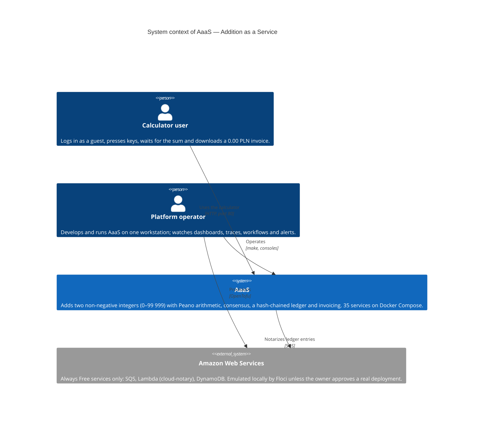

# C4 Level 1 — System Context

| Field | Value |
| --- | --- |
| Document | C4 System Context Diagram |
| Owning Team | Platform Enablement Guild (PEG) |
| Classification | INTERNAL |
| Notation | [C4 model](https://c4model.com/), Mermaid `C4Context` |
| Status | Target architecture; the services are delivered step by step ([progress](../../PROGRESS.md)) |
| Related | `CLAUDE.md` (sections 1–3, 10), [service catalog](../../../catalog/services.md), ADR-0010 |

## 1. Purpose

This diagram shows AaaS as a single box: who uses it and which systems outside
its boundary it depends on. It deliberately hides the 35 services, the event
bus and the databases; those belong to the container diagram (C4 level 2),
scheduled for step P11.4.

## 2. Diagram

## 3. Elements

| Element | Type | Description | Responsibility of AaaS towards it |
| --- | --- | --- | --- |
| Calculator user | Person | Anyone with a browser who can reach the gateway on port 80. Logs in with the one-click guest account of the `auth` service. | Correct sum, visible waiting time, an invoice for every addition, nothing else (`CLAUDE.md` section 1). |
| Platform operator | Person | The owner of the workstation running AaaS; plays every team of the fictional organisation. Uses `make` and the consoles exposed on the host (Grafana, Redpanda Console, Temporal UI, Consul, Unleash, Jaeger, OpenBao). | Health checks, metrics, logs, traces, alerts and runbooks for every service. |
| AaaS | Software system (in scope) | All 35 services, the shared infrastructure (Redpanda, Temporal, observability stack) and the microfrontends, started by `make up`. | — |
| Amazon Web Services | External software system | One AWS account restricted to Lambda, SQS and DynamoDB within the Always Free limits; CloudWatch Logs are created automatically with one-day retention (`CLAUDE.md` section 10). | Stay within the free tier: reserved concurrency 1, no VPC, a 1 USD budget alert. |

## 4. Relationships

The diagram carries short labels; this table is the full description.

| From | To | Description | Technology |
| --- | --- | --- | --- |
| Calculator user | AaaS | Every key press is `POST /api/v1/keys`; the display polls `GET /api/v1/tasks/{taskId}`; the timer listens to server-sent events; the invoice is `GET /api/v1/invoices/{taskId}.pdf`. | HTTP through the `gateway` on port 80 |
| Platform operator | AaaS | Starts and stops the system, reads dashboards and traces, inspects workflows and events. | `make`, web consoles on the ports of `CLAUDE.md` 6.2 |
| AaaS | Amazon Web Services | After each ledger append, the `ledger` service sends a copy of the entry to SQS; the `cloud-notary` Lambda verifies the hash chain and stores the copy in DynamoDB. | SQS (AWS SDK); Floci endpoint by default |
| Platform operator | Amazon Web Services | Creates the queue, function and table with OpenTofu from `infra/aws/`; against real AWS only with explicit approval. | OpenTofu |

## 5. What Is Deliberately Absent

- **No external identity provider.** Authentication is performed by the
  `auth` service (Keycloak) inside the system boundary.
- **No payment provider, e-mail or other third-party API.** The invoice
  amount is always 0.00 PLN and the cost budget is 0 PLN (`CLAUDE.md`
  section 1).
- **No public internet exposure.** Public access is the deferred Phase 12.
